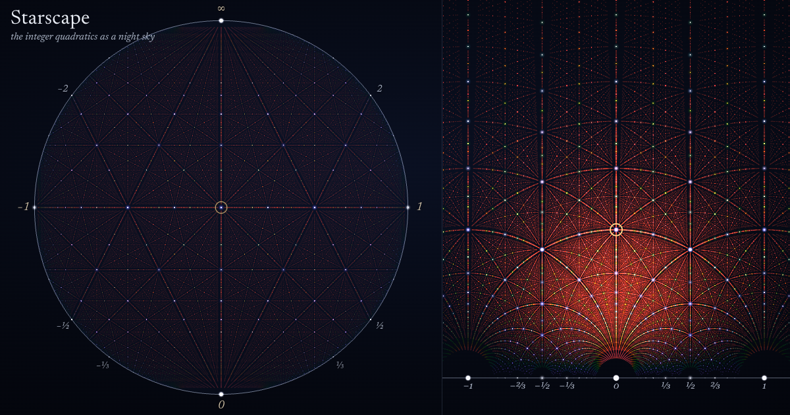

# Starscape

**The integer quadratics as a night sky.** Every polynomial `ax² + bx + c` with integer coefficients is a point of ℤ³. Stand at the origin, the zero polynomial, and look up: your sky is the hyperbolic plane, and its stars are the algebraic numbers of degree two.

**[Open Starscape](https://alok.blog/starscape/)**. It runs in any modern browser. On a headset it offers **Enter VR**.



This is an independent implementation inspired by **Katherine E. Stange**’s [Starscape / Lattice viewer](https://www.katestange.net/starscape-lattice/) and her talk [Illustrating Mathematics](https://katestange.net/talks/math-exploration/). The mathematics is from **Edmund Harriss, Katherine E. Stange and Steve Trettel**, [*Algebraic Number Starscapes*](https://arxiv.org/abs/2008.07655) (§4.2). The L/R coding of geodesics is due to **Caroline Series**, [*The Modular Surface and Continued Fractions*](https://doi.org/10.1112/jlms/s2-31.1.69) (1985). No code or media from the original viewer is included.

## What the 3D medium adds

The tour follows Stange's seven chapters and adds a few things that only a spatial view can show:

- **Brightness is perspective.** Seen from the origin, `k·f` sits `k` times farther than `f` and has `Δ = k²Δ_f`, so a star's brightness falls like `1/|Δ|`. Simpler numbers shine brighter, the same rule that dims complicated numbers in plots of algebraic numbers. Every multiple hides exactly behind its primitive form, and leaning your eye off the origin shows them by parallax.
- **Geodesics are straight because you see planes edge-on.** A plane through your eye looks like a line, which is why the Klein model's geodesics are chords.
- **Ford circles are the stars on the horizon.** In the half-plane a star has radius `1/2a`. A double-root form `k(qx − p)²` lies on the light cone, and its picture is a horocycle: drawn as a disk (⚙ → disks, or chapter V's *Disks*), it is a ring tangent to ℝ at `p/q` with radius `∝ 1/2kq²`. The lattice includes these forms up to the star depth, so the Ford circles appear, each scaled by `R₀` about its point of tangency (exactly the Ford circles at `R₀ = 1`, larger than the viewer draws). `test/picture.test.js` checks the shader's CPU mirror: centers, radii, tangency of Farey neighbors, SL₂(ℤ)-invariance and the Poincaré picture.
- **Dragging the sky is a Lorentz boost.** ρ identifies PSL₂(ℝ) with SO⁺(2,1). Stars slide along their shells `Δ = const`, and releasing settles on SL₂(ℤ), where the lattice lands on itself.
- **Live inside the plane.** The *Inside* view puts you at the center of the Poincaré disk, at your own position in H², and walking applies true hyperbolic translations. The ground carries the Farey tessellation, whose edges are exactly the planes of the forms with `Δ = 1`, because `(qx − p)(sx − r)` has discriminant `(ps − qr)²`. Walk straight and your left/right turns spell the continued fraction of where you are heading. Lower your eye to zero and you see what a Flatlander sees: one line, all the way around. This is exact, because the disk is conformal and centered on you.

## Side by side

On a wide screen the roots pane sits beside the lattice, as in Stange's viewer. It shows the same stars in the Klein model, the Poincaré disk or the upper half-plane, and the picture morphs so geodesics bend as the stars do. Drag either side and both move. A selection, a hover or a cut plane shows in both. Inside, the pane is a fixed map with you walking on it.

## In a headset

**Enter VR** puts your head at the origin, the lattice on a table, or the hyperbolic plane on your floor, depending on the vantage. The interface is visionOS-style glass in the world. Some gestures to try:

- Pinch a star with each hand: the necklace through both appears.
- Pinch and twist your wrist: the sky turns about the point you face.
- Hold an open palm up: the glass comes to your hand.
- Inside, walking in your room walks you through H².

## Points, color and brightness

By default every point is drawn the same tiny size, because these are points of a lattice. **Color** is the invariant `|Δ|`, read as photon energy: violet for the simplest numbers, red as the discriminant grows, on Stange's fixed logarithmic range 3…240. The light cone is white. **Brightness** is the light you would receive standing at the origin, `(4/|v|²)^β`. Settings switch to disks sized by hyperbolic radius, as in her viewer, and offer other palettes. See [the guide](docs/GUIDE.md) for the derivations.

## Run it

It is a static site with no build step. three.js r180 is vendored in `vendor/`.

```bash
python3 scripts/serve.py 8848     # then open http://127.0.0.1:8848
node --test test/                 # the mathematics: fixtures, invariants, Farey/Δ = 1, walking, float32
node scripts/shoot.mjs "http://127.0.0.1:8848/#c=5" phone.png --size 390x844 --mobile   # true phone screenshot
node scripts/film.mjs scripts/reel.mjs tour.mp4 --fps 60 --scale 2 --out 1920x1080       # the demo video, frame by frame
```

## Layout

```
src/math/     forms (Δ, kinds, text, lattice), sl2 (Möbius, ρ(g), snap to SL₂(ℤ)),
              models (Klein ↔ Poincaré ↔ half-plane), planes (geodesics), flatland (walking, Farey, L/R),
              picture (where each star is drawn in each picture: the shader's CPU mirror)
src/render/   stars (one GPU point cloud: ρ(g) and the picture morph run in the vertex shader),
              scenery (cone, screen, rays, planes, shells), flatland (the Farey ground shader), palette
src/views/    rig: Outside, Origin and Inside vantage points
src/ui/       chapters (the tour), xr (WebXR)
lean/         the Lean 4 version: kernel-checked identities and an exact data bridge
lean-float/   on FloatLib: the shader's float32 Δ and plane test are exact (where it matters, with a runtime guard)
scripts/      no-cache dev server; headless screenshots at exact device sizes; a deterministic video recorder
              (film.mjs) and the demo reel it plays (reel.mjs)
```

## What is checked, and how

- **Unit tests** (`node --test`): the radius-6 fixture has 480 points; star counts; root text; class numbers; ρ(g) moves roots by g and preserves Δ; model round trips; the (1,0,1)–(1,1,1) plane `2a − 2c = 0` with endpoints ±1; the snap counterexample −0.4+0.1i → −0.4+i settles on T⁴ and sends (13,20,34) to (13,−84,162); Farey edges are exactly the Δ = 1 forms; walking moves you the stated hyperbolic distance; walking toward φ alternates L and R.
- **Lean 4** (`lean/`): see [its README](lean/README.md) for which statements are kernel-checked, which are `decide` fixtures and which are compiled tests.
- **The GPU's arithmetic** ([`lean-float/`](lean-float/README.md), on FloatLib): the shader's float32 Δ is exact, and its plane test marks exactly the stars on the plane whenever the products stay below 2²⁴. The app checks that bound at runtime; `test/float32.test.js` replays the shader with `Math.fround`.
- **Visual and device behavior** is checked in desktop Chrome and under phone emulation (390×844, touch). WebXR has been exercised in an emulator, not yet on a physical headset.

MIT licensed. three.js is © its authors, MIT.
